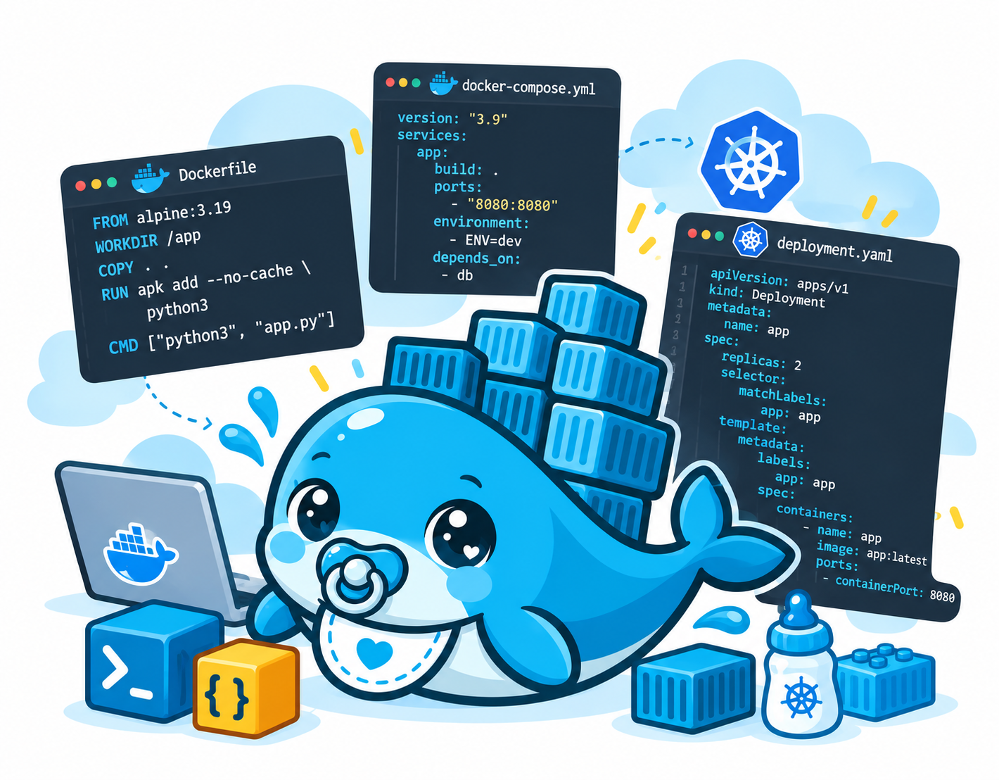
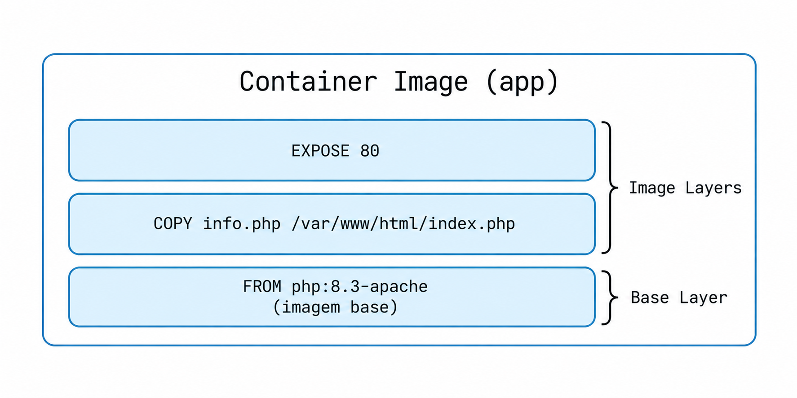
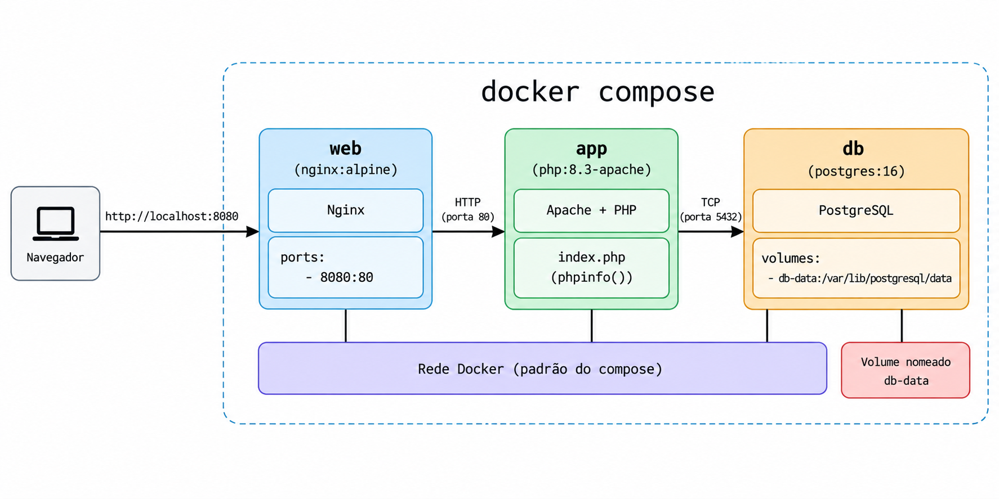
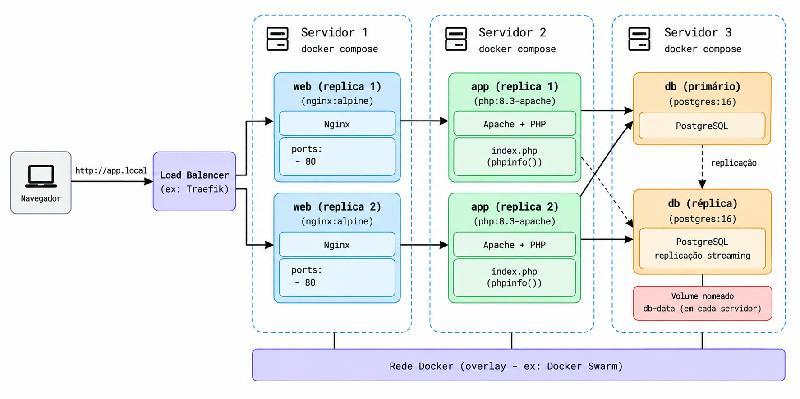
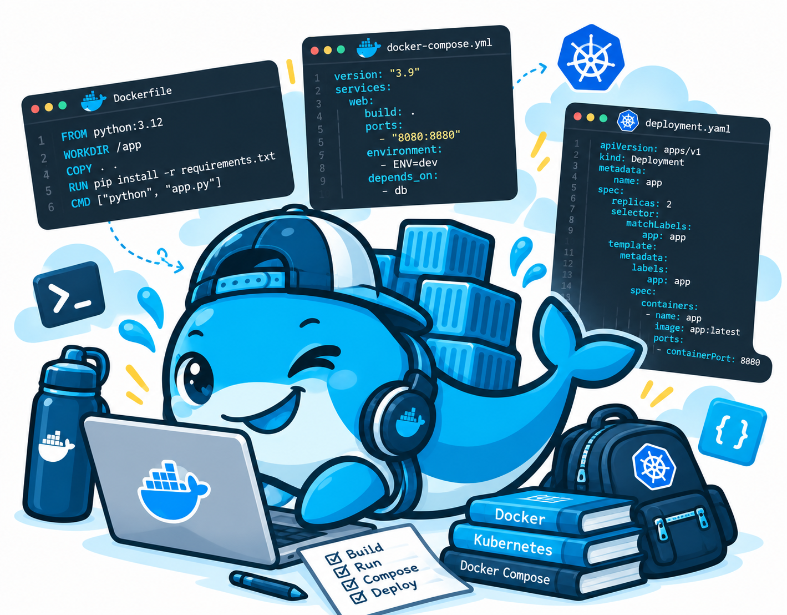

<!--
footer: Repositório desta apresentação https://github.com/andreyev/docker-para-iniciantes
-->


# **Imersão docker para iniciantes no LHC**

## Parte 1

<!--
header: Imersão docker para iniciantes no LHC
footer: Repositório desta apresentação https://github.com/andreyev/docker-para-iniciantes
-->

---

Repositório desta apresentação https://github.com/andreyev/docker-para-iniciantes


---

_Disclaimer_ #0:
- Uma GIA(ChatGPT-4) auxiliou a confecção desta apresentação e das imagens.
- As opiniões expressas neste documento são de responsabilidade exclusiva do autor e não refletem necessariamente as opiniões ou posições de quaisquer organizações, instituições ou entidades com as quais o autor esteja associado. As informações e visões apresentadas são de caráter pessoal e não devem ser interpretadas como uma representação oficial ou endosse de quaisquer organizações ou partes externas.

---

_Disclaimer_ #1:
> _TIMTOWTDI_

---

_Disclaimer_ #2:
>  docker ~ container

---

## Referências
* https://livro.descomplicandodocker.com.br/
* https://www.docker.com/play-with-docker/

---

## Agenda
* Conceitos
* Docker
* Docker compose
* Docker swarm (de relance)

---

## Conceitos
* Dockerfile + arquivos da aplicação
* Build
* Imagem
* Deploy
* Container

---


---

### info.php

```
<?php
phpinfo();
```

---

### Dockerfile

```
FROM php:8.3-apache

COPY info.php /var/www/html/index.php

EXPOSE 80
```
---



---

# Comandos
## 1. Conhecendo o Docker

* `help`: `docker help`
* `info`: `docker info`
* `login`: `docker login`

---

# Comandos
## 2. Trabalhando com imagens

* `pull`: `docker pull nginx:alpine`
* `images`: `docker images`
* `build`: `docker build -t meu-site:1.0 .`
* `history`: `docker history nginx:alpine`
* `tag`: `docker tag meu-site:1.0 usuario/meu-site:1.0`
* `push`: `docker push usuario/meu-site:1.0`
* `manifest`: `docker manifest inspect nginx:alpine`

---

# Comandos
## 3. Criando e executando containers

* `run`: `docker run hello-world`
* `run`: `docker run -d --name web -p 8080:80 nginx:alpine`
* `ps`: `docker ps`
* `ps -a`: `docker ps -a`
* `port`: `docker port web`
* `logs`: `docker logs web`

---

# Comandos
## 3. Criando e executando containers
* `exec`: `docker exec -it web sh`
* `top`: `docker top web`
* `stats`: `docker stats web`
* `inspect`: `docker inspect web`
* `events`: `docker events`

---

# Comandos
## 4. Controlando o ciclo de vida

* `pause`: `docker pause web`
* `unpause`: `docker unpause web`
* `stop`: `docker stop web`
* `start`: `docker start web`
* `restart`: `docker restart web`
* `update`: `docker update --cpus 1 web`
* `rm`: `docker rm -f web`

---

# Comandos
## 5. Gerenciando recursos

* `container`: `docker container ls -a`
* `image`: `docker image ls`
* `network`: `docker network ls`
* `volume`: `docker volume ls`
* `plugin`: `docker plugin ls`
* `system`: `docker system df`

---

# Comandos
## 6. Limpando o ambiente

* `docker container prune`: Remove containers parados
* `docker image prune`: Remove imagens não utilizadas
* `docker volume prune`: Remove volumes não utilizados
* `docker network prune`: Remove redes não utilizadas
* `docker system prune`: Limpa recursos não utilizados

---

# docker compose

---



---


### docker-compose.yml
```
services:
  web:
    image: nginx:alpine
    ports:
      - "8080:80"
    volumes:
      - ./nginx/default.conf:/etc/nginx/conf.d/default.conf:ro
    depends_on:
      - app

  app:
    build: ./app
    environment:
      DB_HOST: db
    depends_on:
      - db

  db:
    image: postgres:16
    environment:
      POSTGRES_DB: app
      POSTGRES_USER: app
      POSTGRES_PASSWORD: ${POSTGRES_PASSWORD:-dev-password}
    volumes:
      - db-data:/var/lib/postgresql/data

volumes:
  db-data:
```

---

# Comandos
## 1. Configuração e inicialização

* `version`:
* `config`: `docker compose config`
* `build`: `docker compose build`
* `pull`: `docker compose pull`
* `up`: `docker compose up -d`
* `up --build`: `docker compose up --build -d`
* `create`: `docker compose create`
* `start`: `docker compose start`

---

# Comandos
## 2. Inspecionando os serviços

* `ps`: `docker compose ps`
* `images`: `docker compose images`
* `logs`: `docker compose logs`
* `logs -f`: `docker compose logs -f`
* `top`: `docker compose top`
* `events`: `docker compose events`

---

# Comandos
## 3. Executando comandos nos serviços

* `exec`: `docker compose exec app sh`
* `run`: `docker compose run --rm app php -v`
* `cp`: `docker compose cp app:/var/www/html/index.php .`

---

# Comandos
## 4. Controlando os serviços

* `stop`: `docker compose stop`
* `start`: `docker compose start`
* `restart`: `docker compose restart`
* `pause`: `docker compose pause`
* `unpause`: `docker compose unpause`
* `kill`: `docker compose kill`
* `rm`: `docker compose rm -f`

---

# Comandos
## 5. Atualização e encerramento

* `build`: `docker compose build --no-cache`
* `pull`: `docker compose pull`
* `up`: `docker compose up -d`
* `down`: `docker compose down`
* `down -v`: `docker compose down -v`

---

# docker swarm

---



---

<!-- _class: docker-return -->

# DOCKER WILL RETURN

<style>
section.docker-return {
  background: #000 !important;
  color: #fff !important;
  display: flex;
  justify-content: center;
  align-items: center;
  text-align: center;
}

section.docker-return h1 {
  color: #fff !important;
  font-size: 64px;
  border: none;
}
</style>

---
<!--
footer: Repositório desta apresentação https://github.com/andreyev/docker-para-iniciantes
-->


# **Imersão docker para iniciantes no LHC**

## Parte 2

---
Repositório desta apresentação https://github.com/andreyev/docker-para-iniciantes

<!--
header: Template de apresentação em MARP
footer: Repositório desta apresentação https://github.com/andreyev/docker-para-iniciantes
-->
